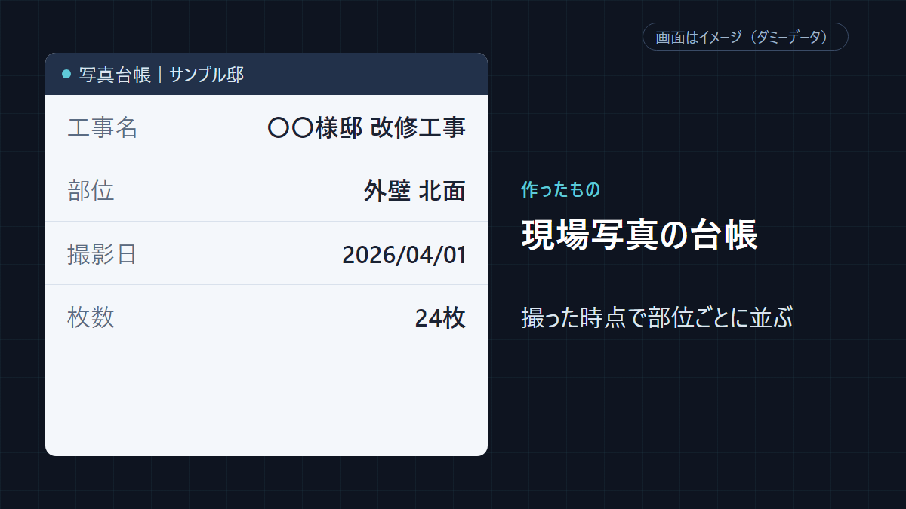
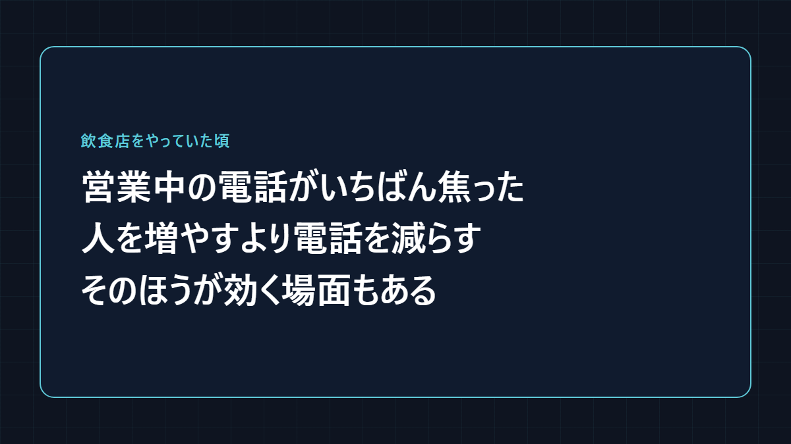
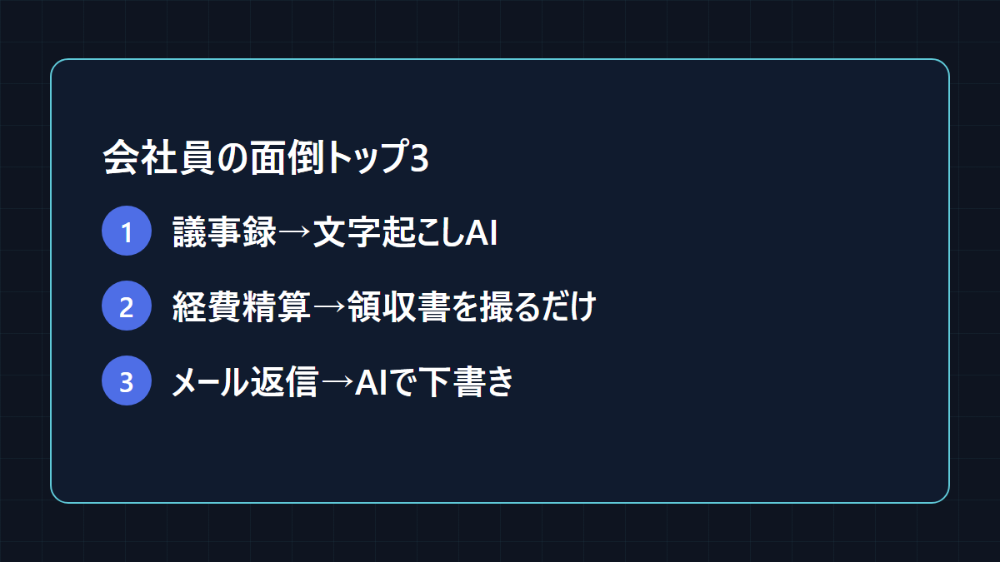
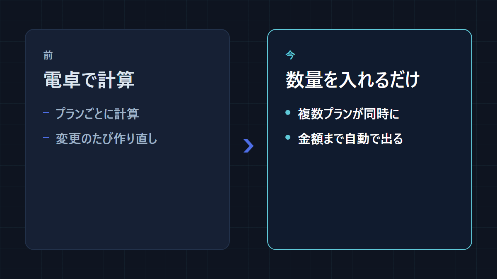
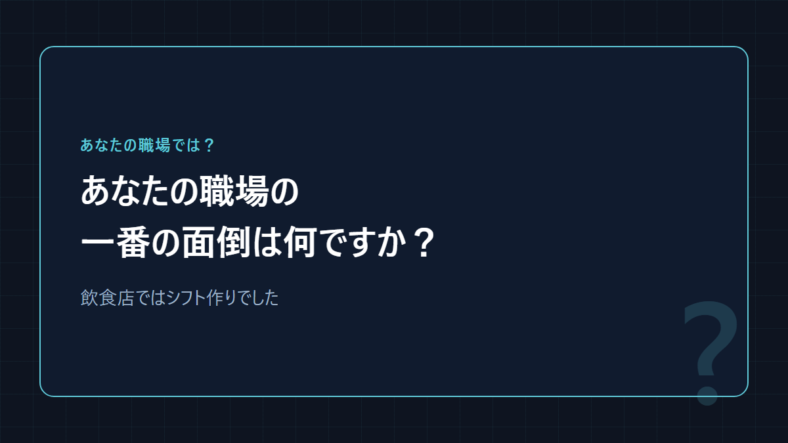

# X の投稿サンプル（型1〜5・data/content-guide.md の新しいルールで作成・投稿はしていない）

作成: 2026-10-17 18:16（scripts/x-plan.py samples）。材料の記事: 帳簿付け・請求書・献立の手間を自動化する方法｜毎月と毎日の作業を仕組みに任せる

## 1. 実物を見せる型（jitsubutsu）

```
写真の仕分けは、撮る瞬間に終わらせられます。
現場写真を撮るとき、先に部位を選ぶ仕組みを作りました。
撮った写真は、そのまま部位ごとに台帳へ並びます。
戻ってから一枚ずつ見返して振り分ける作業が、撮るときの一手間に変わりました。
```

1行目 22 字・225/280



## 2. 体験＋意見の型（taiken）

```
営業中に鳴る電話が、いちばん焦りました。
手を止めて出れば料理が遅れ、出なければ予約を逃す。
人を増やすより、電話そのものを減らすほうが効く場面もあると思っています。
ネット予約や自動応答は、そのための道具の一つです。
```

1行目 20 字・215/280



## 3. まとめの型（matome）

```
会社員の面倒トップ3、いまある道具で減らせます。
1. 議事録→文字起こしAIで録音から作成
2. 経費精算→領収書をスマホで撮って読み取り
3. メールの返信→要点を伝えてAIに下書き
自動化ランキングの会社員の上位からです。
```

1行目 24 字・210/280



## 4. Before/After の型（beforeafter）

```
プランを変えるたび、見積を最初から計算し直す。
前：電卓で数量を計算し、プランごとに作り直し
今：数量を入れるだけで、複数プランの見積が同時に出るまで自動で
建設・リフォーム向けに作った見積の仕組みです。
```

1行目 23 字・201/280



## 5. 問いかけの型（toikake）

```
シフトを組む夜は、なかなか終わりませんでした。
希望を集めて、重ならないように並べて、急な休みでまた組み直す。
どの職場にも、こういう手間が一つはあると思います。
あなたの職場の一番の面倒は何ですか？
```

1行目 23 字・197/280


